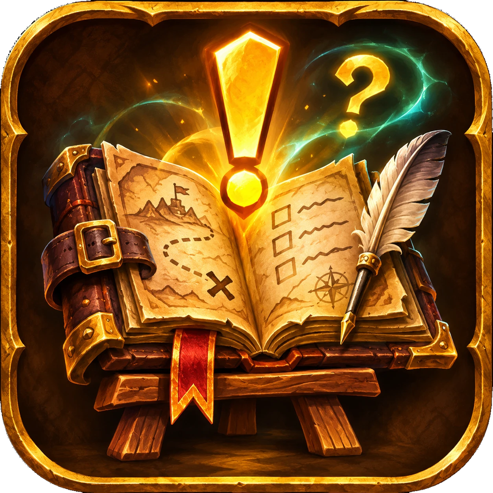

# CustomQuests

**Write your own quests. Track them like the real thing.**

CustomQuests lets you create quests for roleplay and for your own goals, with a quest journal, an on-screen tracker and a turn-in window that look and feel like the game's own. Write a five-part campaign for your guild's RP night, or a "20 Iron Ore" reminder for your next farming session: the addon follows your progress on its own, and you can share any quest as a short piece of text.

One package for **Retail** and **WoW Forever**. English, Spanish, German and French.

## Features

### Quest journal (`/cq`)
- **Active**: the quests you have accepted, with their story, current stage and objectives. Manual objectives get **+** and **−** buttons.
- **Templates**: every quest you have written or imported, ready to accept. Chains show as a tree you can fold, and each template shows how many times you've completed it.
- **History**: every quest you've completed, how many times and when last.
- Templates and history are shared by all your characters; active quests belong to each character.
- The journal, editor, turn-in and import/export windows can be resized from their bottom-right corner, and the journal's list divider can be dragged.

### Tracker
- A floating tracker in the style of the game's objective tracker, with live progress and a header you can rename.
- Right-click a quest title to fold it, or the header to fold everything. Left-click opens the journal.
- Click **+** on a manual objective to count it (right-click to take one back).
- Shift+drag moves it; hold Shift and drag the corner grip to resize it; the mouse wheel scrolls when the quests don't fit.
- Appearance options: font (including SharedMedia fonts if you have them), text size, background colour and opacity, border style and colour, with a live preview (`/cq options`, or Options > AddOns > CustomQuests).

### In-game editor
- Title, quest giver, type (Roleplay or Personal), repeat mode, level range, section and chain link.
- Description, reward and completion texts with a **colour toolbar**, buttons for the `{name}`, `{class}` and `{race}` tokens, and a **live preview**.
- Up to 20 stages per quest and 10 objectives per stage.
- A **Help** button explains where each ID comes from, and helper buttons fill fields in for you (see [Finding IDs](#finding-ids)).

### Objective types
| Type | Completes when | Notes |
|---|---|---|
| **Item** | You have N of an item in your bags | Counts what's in your bags right now: spending items lowers the count. |
| **Kill** | Your group kills N of an NPC, or N of any enemy on a map | NPC, map, or both. Inside instances the game hides which NPC died; tick *Approximate in instances* to count any group kill on that map. |
| **Boss** | You defeat a dungeon or raid boss | Uses the encounter ID, exact in dungeons and raids. |
| **Zone** | You enter a zone | Also counts from any area inside that zone. |
| **Subzone** | You reach a named place (the name under the minimap) | For example a town or camp inside a zone. Names follow your game language. |
| **Location** | You stand close to a spot on the map | Radius in percent of the map. |
| **Level** | Your character reaches a level | |
| **Manual** | You count it yourself | For roleplay steps such as "Talk to the innkeeper". |

### Stages and chains
- **Stages** are steps inside one quest: one journal entry, one reward, one line in History. The next stage starts when the current one is done.
- **Chains** link separate quests: the next quest unlocks, and is accepted on its own, when this character turns in the one before. A quest can have several follow-ups, so chains can branch. In Templates, **+ Add next quest** creates the next link for you.
- Quests can require a minimum and/or maximum level, checked when you accept them.

### Repeatable quests
- **One-time**, **Daily** or **Weekly**. A completed daily or weekly quest comes back on its own after the game's daily or weekly reset.
- Quest icons are the game's own: campaign for chains, recurring for dailies and weeklies, and the regular quest icon for the rest.

### Turn-in window
- When every objective is done you get an on-screen message and a sound, and the quest shows the yellow turn-in icon.
- Click it (or **Complete** in the journal) to open the turn-in window with your own completion text and reward, then complete the quest.
- On-screen messages also announce objective progress and new stages, like real quests.

### Sections
- Group templates under headers you make up ("The Ember Oath", "Dailies and Weeklies"...).
- Templates, Active and the tracker all show the headers, each with a fold button. Quests without a section go last, under "Other quests".
- Right-click a header to rename, move, export or delete it. Deleting a section keeps its quests. In Templates, **Edit list** lets you tick several quests to move them to a section or delete them at once.
- A chain always moves as a whole.

### Sharing: export and import
- Export a quest, a whole chain or a whole section as a single line of text starting with `CQ1:`. Paste it in chat, Discord or a forum.
- Import it on any character or account: sections are matched by name or created.
- **Importing never runs code.** The text is plain data read by the addon's own parser, checked against the quest format, with unknown fields dropped and size limits applied. Quest texts are shown as plain text; the only formatting is the colour tag.

### Minimap button
- Left-click opens the journal, right-click shows or hides the tracker, Shift+drag moves it. `/cq minimap` hides or shows it.

## Slash commands

| Command | What it does |
|---|---|
| `/cq` or `/customquests` | Open or close the journal |
| `/cq tracker` | Show or hide the tracker |
| `/cq options` | Tracker appearance settings |
| `/cq minimap` | Hide or show the minimap button |
| `/cq sample` | Add the example quests to Templates |
| `/cq reset` | Bring back completed daily and weekly quests now (for testing) |
| `/cq debug` | Print the current map ID, last boss encounter and your quests' state |
| `/cq help` | List the commands |

## Quick start

1. Type `/cq` and click **Templates**, then **New**.
2. On **General**, give the quest a title and choose whether it repeats.
3. On **Description**, write the story. Click a colour square to colour text up to **End color**, and use `{name}`, `{class}` and `{race}` to address whoever reads it. The preview shows the result.
4. On **Objectives**, pick a type and fill it in (the helper buttons do most of the work). Add more objectives or stages as you like.
5. Save, select the quest in Templates and click **Accept**. It appears in the tracker and counts on its own.
6. When it's done, click the yellow turn-in icon and complete it.

Want to see some examples first? `/cq sample` adds a couple of ready-made quests.

## Finding IDs

- **Items and NPCs**: search them on [Wowhead](https://www.wowhead.com). The number in the page address is the ID: `wowhead.com/item=2772` is item 2772, `wowhead.com/npc=448` is NPC 448.
- **Item**: click the ID box and shift-click the item in your bags, a vendor window or a chat link.
- **Kill**: target the NPC and press **Target** to fill in its ID and name.
- **Boss**: defeat the boss once, then press **Last boss** to fill in the encounter.
- **Zone and Subzone**: stand there and press **This map** or **This subzone**.
- **Location**: stand on the spot and press **My spot**, then set the radius.
- `/cq debug` prints the map ID you are on and the last boss encounter.

## Sharing quests

- Select a template and click **Export**. If it belongs to a chain, the whole chain is exported. To share a section, right-click its header > **Export section**.
- Copy the text with Ctrl+C and send it.
- The other player opens `/cq` > **Templates** > **Import**, pastes it and clicks **Import**.
- Limits: 16 KB of text, 20 stages per quest, 10 objectives per stage, 50 quests per chain or section.

## Tips

- Use **Personal** for your own goals and **Roleplay** for story quests with a quest giver; the type shows in the journal.
- Use stages for "do this, then that" inside one story, and chains when each part deserves its own quest, reward and turn-in.
- A weekly quest with a few **Boss** objectives makes a handy transmog or mount farming checklist.
- `{class}` is shown in your class colour.
- Subzone names depend on the game language: a quest shared between players on different languages works best with **Zone** or **Location** objectives.

## Compatibility

- **Retail** (12.x, interfaces 120001 and 120105) and **WoW Forever** (interface 16001), from one package. The addon detects the client when it loads and warns in chat on any other client.
- Forever support is new and hasn't been fully tested in game yet: please report anything that doesn't work.
- No libraries required. If LibSharedMedia is loaded by another addon, its fonts appear in the tracker options.
- In instances the game hides which NPC died, so **Kill** objectives there count approximately (see Objective types). **Boss** objectives are exact.

## Installation

- **CurseForge app**: search for CustomQuests and install.
- **Manually**: download the zip and extract the `CustomQuests` folder into `World of Warcraft/_retail_/Interface/AddOns/` (or the AddOns folder of your Forever client). Restart the game or `/reload`.

## FAQ

**Can other people see my quests?**
No. Quests live in your own saved variables. To give one to someone, export it and send them the text.

**Is it safe to import text from strangers?**
Yes, as far as code goes: imported text is read as data and never executed, and anything that doesn't fit the quest format is rejected. Quest texts are shown literally, so they can't hide links or game formatting codes.

**Why doesn't my kill count inside a dungeon?**
The game hides which NPC died inside instances. Tick *Approximate in instances* on the objective (it needs a map ID), or use a kill objective with only a map ID, or a **Boss** objective for bosses.

**My item objective went down.**
Item objectives count what's in your bags right now, so selling, using or banking the items lowers the count.

**I changed a template. Why didn't my active quest change?**
An accepted quest keeps a copy of the template from when you accepted it, so editing never breaks a quest in progress. Abandon and accept it again to use the new version.

**Why can't I accept the second quest of a chain?**
Only the first quest of a chain is accepted by hand. The rest start on their own when you turn in the quest before them.

**When does a daily or weekly quest come back?**
After the game's daily or weekly reset once you've completed it. A quest you haven't finished keeps its progress through the reset.

## Feedback and issues

Bug reports and ideas are welcome on GitHub: <https://github.com/xsansebastian/CustomQuests/issues>. For errors, please include the message from `/console scriptErrors 1` and whether you play Retail or Forever.

## For developers

| File | Role |
|---|---|
| `Compat/Common.lua` | The only file that calls client APIs (`ns.api`); detects Retail or Forever by build number. |
| `Util.lua`, `Model.lua` | Helpers, schema, validation, SavedVariables. |
| `Serializer.lua` | `CQ1:` export/import; never executes imported text. |
| `Objectives.lua`, `Lifecycle.lua` | Progress engine, stages, chains, resets, history. |
| `Samples.lua` | The example quests added by `/cq sample`. |
| `Core.lua` | Events and slash commands. |
| `UI/` | Tracker, journal, editor, turn-in window, dialogs, minimap button, options. |
| `Locales/` | enUS (base), esES, deDE, frFR. |
| `tests/run.lua` | Offline tests. |
| `tests/INGAME.md` | Manual checklist for the game client. |
| `tools/make_test_imports.lua` | Writes `tests/imports/`: import texts covering every kind of quest, for testing in game. |
| `tools/make_screenshot_imports.lua` | Writes `screenshots/imports/`: polished quests for the screenshot gallery. |
| `tools/build.py`, `.pkgmeta` | Build the single package for both clients. |
| `SPEC.md`, `docs/decisions/` | Specification and architecture decision records. |

- **Tests**: `luajit tests/run.lua` from the addon folder (LuaJIT has Lua 5.1 semantics, like the game).
- **Build**: `python tools/build.py` writes `dist/CustomQuests-<version>.zip` with only the files the TOC loads, plus the TOC, icon and this README. CurseForge packages from `.pkgmeta`, which leaves out `tests`, `tools`, `docs`, `assets`, `screenshots` and `SPEC.md`.
